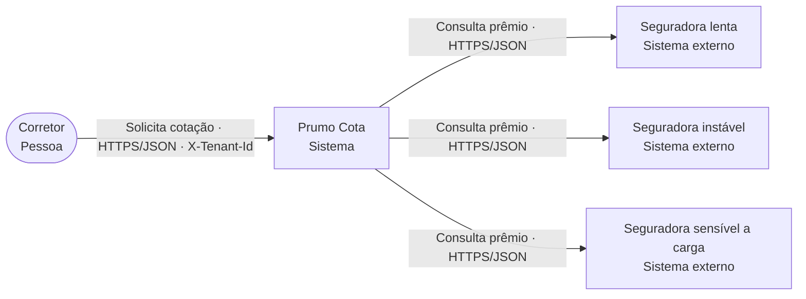
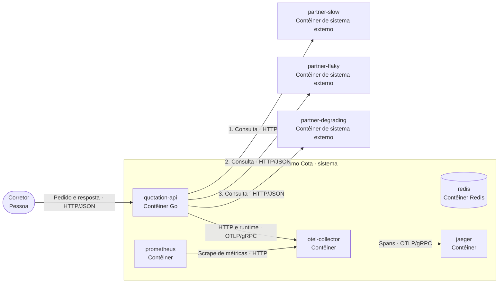
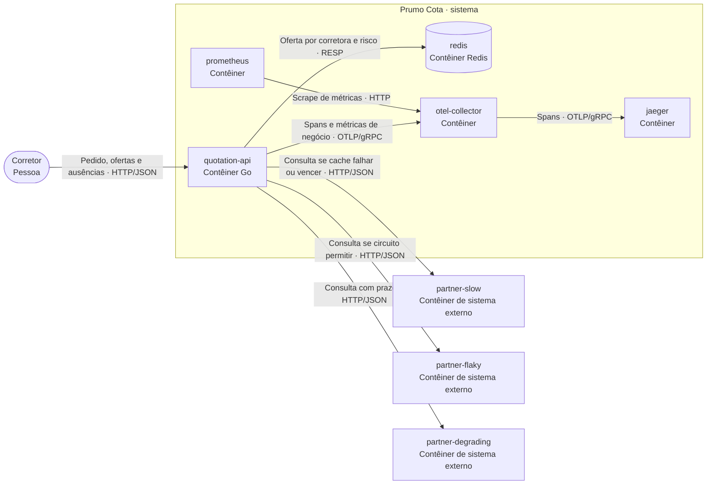
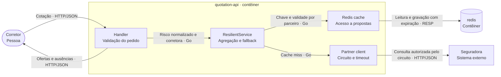

# Prumo Cota — arquitetura da cotação

## 1. Introdução

A aprovação que este documento pede é para testar proteção na fronteira com as três seguradoras e comparar o custo por cotação entregue. O CTO precisa da conta da seção 8, o plantão precisa dos sinais da seção 6 e a auditoria precisa conseguir relacionar a proposta exibida à consulta de origem.

O cenário fixa Go, três parceiras externas, PoC local sem custo e cobrança de R$ 0,04 por consulta. A Prumo intermedeia as propostas e atua como operadora dos dados da corretora. O [enunciado](enunciado.md) também fixa o teto comercial de 24 horas e a retenção auditável por cinco anos. O desenho encerra no retorno da cotação. Precificação, emissão, CRM e cobrança ficam fora deste fluxo.

| Pressuposto | Origem | Se estiver errado |
| --- | --- | --- |
| Entre 12% e 28% das consultas podem reaproveitar um risco idêntico na mesma corretora em até quatro minutos | Hipótese para medir em piloto. O cenário descreve recotações durante o atendimento, e trocas entre corretoras ficam fora da conta. | Se o piloto ficar abaixo de 2%, a economia deixa de cobrir com folga a operação estimada na seção 8. |
| Uma resposta com ao menos uma oferta, indicando quais ficaram de fora, pode ser apresentada e cobrada | Premissa comercial para a comparação de receitas. A API atual já informa preço e origem de cada oferta. | Se o produto exigir três ofertas, operações degradadas passam a ser indisponíveis na conta e o fallback precisa ser revisto. |
| Um registro de auditoria com até três referências de origem ocupa 1 KiB em média | Orçamento de desenho para envelope mínimo, com identificador pseudônimo, corretora, valores e instantes. | Se o piloto medir 2 KiB, o volume de retenção e a parcela de armazenamento da seção 8 dobram. |

## 2. Visão geral

### C4 nível 1

O prêmio que volta para o corretor tem origem na seguradora. O que muda é o tempo que a Prumo espera, quando vale repetir uma consulta e o que a API entrega se uma seguradora faltar.

### C4 nível 2, antes

O Redis já existia ocioso no Compose. No [trace de referência](evidencias/antes-trace.json), as três chamadas aparecem em sequência. Sob carga, atrasar uma delas atrasava o retorno todo. Uma falha abortava a cotação, conforme o [relatório](evidencias/antes-carga.txt).

### C4 nível 2, depois

- A API consulta o Redis por seguradora e compartilha o resultado apenas dentro da corretora.
- Cada integração tem seu circuito. As três consultas podem sobrepor o tempo de espera.
- Uma ausência deixa de invalidar as outras propostas. A corretora passa a receber origem e disponibilidade no mesmo retorno.

## 3. Requisitos

| ID | Requisito funcional | Verificação |
| --- | --- | --- |
| RF-01 | `POST /quotes` exige `X-Tenant-Id` de uma corretora habilitada. | Testes do handler para ausência, desconhecido e válido. |
| RF-02 | As propostas disponíveis chegam ordenadas por prêmio, com identificador original da seguradora. | Teste de agregação e contrato da resposta. |
| RF-03 | A mesma entrada normalizada em duas corretoras gera duas chaves e duas consultas independentes. | Teste com duas corretoras e cache em memória. |
| RF-04 | Cada proposta entregue indica origem e horário da consulta. Um acerto devolve a idade e a validade remanescente. | Duas cotações seguidas e comparação dos identificadores. |
| RF-05 | Havendo oferta parcial, a API indica a parceira ausente. Sem oferta, devolve 503 com motivo e ação. | Testes de fallback e contrateste de todas as parceiras indisponíveis. |
| RF-06 | Em produção, cada apresentação gera um registro imutável com corretora, seguradora, prêmio, instante e referência à consulta de origem. | Proposta de produção. Recuperar um registro servido de cache durante o prazo de cinco anos, conforme seções 5 e 7. |

| ID | Métrica | Antes medido | Alvo | Verificação e origem |
| --- | --- | --- | --- | --- |
| RNF-01 | p95 de `POST /quotes` sob a carga padrão | 8,01 s | Até 2,4 s | Relatório de 200 pedidos com 50 em voo, apoiado pelo histograma HTTP. O teto permite os 2 s da parceira e 0,4 s para cache, agregação e rede. |
| RNF-02 | Pedidos com ao menos uma oferta sob a carga padrão | 60% | Pelo menos 98% | Respostas 200 no gerador. A meta pressupõe que ao menos dois fornecedores tenham falhas independentes e que o lento ainda caiba em 2 s. |
| RNF-03 | Vazão na carga padrão | 8,1 pedidos/s | Pelo menos 25 pedidos/s | Tempo do estágio do gerador. Valor mínimo para 200 pedidos em até 8 s, aceito para comparar este cenário local. |
| RNF-04 | Duração de uma consulta de parceira | 6,16 s no caminho crítico do trace longo, aproximadamente | Timeout de 2 s por tentativa | Histograma de cliente por parceiro. O teto cobre os 1,5 s + 200 ms de jitter da lenta com 300 ms de sobra. |
| RNF-05 | Vida máxima de uma entrada no Redis | Cache sem uso | Até 240 s e nunca além do vencimento da oferta | TTL no Redis e relógio de teste. Sobram 60 s na validade default de 300 s para evitar oferecer um preço prestes a expirar. |

## 4. Detalhamento

### Decisão 1 — circuito por seguradora

As falhas são de fornecedores independentes. Um circuito único transforma o problema de um fornecedor em indisponibilidade geral. Um por corretora duplicaria o aprendizado da falha para todas elas. Cada processo, portanto, guarda um circuito por seguradora.

No estado fechado, três falhas consecutivas em até 12 s abrem o circuito. A janela comporta três timeouts de 2 s e a rajada de referência da instável de [factibilidade](smoke-test-factibilidade.md). Erro de rede, timeout do cliente, resposta inválida, 429 e 5xx contam. Cancelar a própria requisição ou rejeitar entrada com outro 4xx não pune a parceira.

Ele fica aberto por 3 s, tempo para deixar de acumular chamadas acima do teto de 2 s. A primeira consulta sem entrada válida após esse período entra em meio aberto e é a única sonda. Sucesso fecha. Falha reabre. Enquanto aberto ou com sonda em curso, o cliente HTTP fica fora do caminho. Um 503 isolado continua chegando ao cliente como ausência dessa parceira. O caminho e a transição ficam visíveis no Jaeger e no Prometheus.

### Decisão 2 — cache de proposta por corretora e seguradora

A chave é `quotation:v1:<tenant_id>:<partner>:<hmac_sha256(normalized_risk_json)>`. Os dois primeiros identificadores são codificados para que separadores tenham significado único. O risco inclui documento, ano de nascimento, placa, modelo, ano, valor e cobertura após a mesma normalização do pedido HTTP. O HMAC usa chave separada do Redis. No PoC, uma chave efêmera sorteada no boot é suficiente. Em produção, réplicas do mesmo serviço compartilham chave gerida fora do Compose.

Cachear a resposta inteira economizaria mais acessos ao Redis, mas uma proposta vencida invalidaria as outras. A entrada individual preserva ofertas válidas durante indisponibilidade. O TTL é o menor entre 240 s e o tempo informado pela parceira. Uma consulta alterada produz outra chave. Trocar a versão do prefixo ou girar a chave deixa de reutilizar os valores antigos, que somem pelo vencimento original. Um circuito aberto não estende validade. O Redis guarda o preço, a referência de origem e a data, sem o corpo do pedido.

O risco fica sob HMAC e campos sensíveis não entram em logs, spans ou métricas. O cache responde por até 75 ms por operação, com o tempo restante da chamada HTTP preservado caso o Redis falhe. A escolha sacrifica acertos antigos e mantém curto o prazo de descarte. Os acertos possíveis que entram no TCO são apenas recotações que cabem nesse intervalo.

### Decisão 3 — resposta parcial com origem

Abortar em qualquer falha jogava fora ofertas utilizáveis. Entregar preço vencido poderia criar uma promessa que o parceiro não honraria. A API entrega as propostas ainda válidas ordenadas por preço. A saída inclui `sources` com seguradora, origem, instante e idade do cache quando aplicável. Se houver ausência, `degraded` e `missing_partners` permitem ao corretor explicar a limitação ao cliente. Se todas faltarem, a API devolve 503, lista vazia e `error=no_quotes_available` com orientação para tentar novamente.

A agregação usa até três tarefas em paralelo por pedido para sobrepor as esperas. Isso reduz a soma de latências, mas antecipa a pressão sobre a parceira que degrada quando passa de cinco chamadas em voo. O timeout transforma esse atraso em falha observável. O PoC não adiciona filas nem repetições automáticas.

### C4 nível 3

| Limite | Quando aparece | Efeito no corretor |
| --- | --- | --- |
| Sem limite de chamadas simultâneas por parceira | Pico de riscos inéditos logo após abrir a operação ou perder o Redis | A degradante passa de cinco chamadas e algumas ofertas faltam até o circuito abrir. |
| Circuito por processo | Escala horizontal ou reinício de réplica durante incidente | As réplicas aprendem a falha separadamente. O mesmo risco pode ter oferta diferente em duas tentativas. |
| Descarte predominantemente por TTL | A seguradora retira uma oferta antes do tempo e não envia aviso | A corretora pode ver uma oferta ainda dentro do TTL até o prazo original. Um canal de invalidação fica para produção. |
| Capacidade compartilhada | Uma corretora dispara uma carga fora do padrão | Timeout e custo aumentam também para as demais. Isolamento de dados continua valendo. |

## 5. Implementação e hospedagem

| Parte | Código e verificação |
| --- | --- |
| Circuito e prazo | [client.go](../internal/partner/client.go) aplica o timeout no HTTP e chama o circuito de [breaker.go](../internal/partner/breaker.go). [Os testes](../internal/partner/breaker_test.go) avançam o relógio e contam chamadas ao servidor. |
| Redis e isolamento | [resilient.go](../internal/quotation/resilient.go) gera a chave e limita a validade. [redis.go](../internal/quotecache/redis.go) usa `go-redis/v9` para leitura, expiração e prazos de rede. |
| Contrato de fallback | [handler.go](../internal/quotation/handler.go) e [request.go](../internal/quotation/request.go) mantêm os códigos de validação e expõem origem e ausências. [Os testes](../internal/quotation/resilient_test.go) cobrem separação por corretora, vencimento, parcial e 503. |
| Configuração e telemetria | [resilience.go](../internal/platform/resilience.go), [main.go](../cmd/quotation-api/main.go) e [docker-compose.yml](../docker-compose.yml) ligam o Redis, os limites e o SDK existente. |

Uma biblioteca de breaker reduziria o código próprio. Para o PoC, o circuito pequeno mantém explícitas a geração das tentativas, o relógio e a única sonda em meio aberto. O custo é assumir a manutenção das transições e dos testes de concorrência. Em produção, reavalie a biblioteca se ela permitir a mesma política e os mesmos sinais.

### Decisão 4 — hospedagem do produto

O ambiente do PoC é local. Para produção, proponho serviço e Redis em rede privada no Brasil, com dois domínios de falha e um segundo site brasileiro para a auditoria. A proposta mantém os dados de cotação perto das parceiras e separa retenção imutável de descarte rápido. A equipe precisa confirmar residência, cláusulas de operação e evidência de imutabilidade antes de contratar.

Um único site próprio daria controle físico, mas exigiria manter a segunda instalação e sua escala. Hospedar a auditoria no exterior facilitaria obter uma região independente, mas introduziria avaliação contratual de transferência antes da entrada em produção. A opção proposta paga redundância e integração de redes. A seção 8 estima esse custo recorrente.

Em produção, a confirmação de entrega deve suceder a gravação do evento imutável em dois domínios. O evento leva corretora, montante, instante da apresentação, origem e referência do parceiro. O PoC entrega a origem à corretora e emite telemetria operacional. O armazenamento de auditoria é uma etapa de produção, com chave própria, controle de acesso e retenção independente do Redis.

## 6. Operação e mudanças

| Sinal | Limiar inicial | Ação |
| --- | --- | --- |
| `sum by (partner) (increase(quote_breaker_transitions_total{to_state="open"}[5m]))` | 3 aberturas em 5 min por parceira | Identificar se houve timeout ou 5xx no Jaeger, confirmar a disponibilidade das alternativas e acionar a parceira. |
| Acertos divididos por consultas da métrica `quote_cache_lookups_total`, com janela de 15 min | Menos de 10% durante 15 min, com tráfego sustentado de pelo menos 100 lookups/min | Conferir reinício, expiração, erro de Redis e mudança na composição do risco antes de reavaliar o TTL. |
| p95 de `/quotes` no histograma `http_server_request_duration_seconds` | Mais de 2,4 s por 5 min com pelo menos 30 pedidos/min | Separar tempo de Redis e de parceira no trace. Confirmar se a queda coincide com um rollout ou com concentração de risco inédito. |

Para a latência de integração, os spans de cliente existentes identificam o destino. Use `http_client_request_duration_seconds_bucket` agrupado por `server_address`. O [índice das evidências](evidencias/README.md) traz as consultas e janelas.

### Plantão — circuito da degradante abrindo repetidamente

1. Confirme os eventos `quote.breaker.transition` e `quote.breaker.rejected` no serviço `quotation-api`. Compare o p95 do cliente para a degradante e a taxa de respostas 503 da própria API.
2. Se apenas a degradante estiver falhando, confirme em uma resposta que as outras ofertas continuam visíveis e que a parceira consta em `missing_partners`. Registre quando apareceu a primeira falha.
3. Verifique se começou após um rollout ou perda de cache. Em caso de aumento de latência por nova versão, reverta a revisão e monitore por 5 min. Se a falha estiver na parceira, encaminhe horário e traços sem dados pessoais.
4. Depois de 10 min de repetição, escale para SRE e gestão da integração. Se a taxa com alguma oferta cair abaixo de 98% por 5 min, o incidente passa a afetar a disponibilidade do produto. Quando a integração voltar, confira um ciclo meio aberto para fechado e o retorno das ofertas antes de encerrar.

Produto e gestão de riscos aprovam mudanças no TTL. Aplique primeiro a uma réplica piloto, compare durante cinco dias úteis o acerto, preço vencido reportado e custo por oferta entregue, com uma coorte de controle. Para voltar, reverta `CACHE_TTL`. Se for necessário encerrar de imediato o reaproveitamento anterior, gire a chave do cache e deixe as entradas antigas vencerem.

## 7. Recuperação

| Dado | RTO | RPO | Fundamentação |
| --- | --- | --- | --- |
| Redis de propostas | 5 min | Cache inteiro | É reconstituível por consulta. A aplicação continua em caminho direto. |
| Configuração de serviço e isolamento | 2 h | Última revisão aprovada | Reprovisionar a revisão conhecida, incluindo chaves e endpoints da camada de segredos. |
| Auditoria de propostas entregues | 2 h | 0 registros confirmados | Proposta de confirmar emissões só com escrita imutável em dois domínios. Retenção por 5 anos. |
| Telemetria operacional | 2 h | Até 15 min | Perder diagnóstico recente afeta operação, enquanto o acervo de auditoria tem trilha separada. |

- **Redis perdido.** No cenário de 28% de acerto e 15 mil pedidos por hora de trabalho, a pressão teórica salta de 32.400 para 45.000 consultas/h. O efeito de latência chega primeiro quando a degradante passa de cinco em voo. A corretora vê ofertas parciais e o serviço continua consultando. Em quatro minutos de cache frio, o teto é R$ 120 em consultas ou R$ 33,60 a mais que no cenário aquecido, antes de considerar rejeições pelo breaker. Reponha o Redis, valide leitura e escrita e espere o hit rate estabilizar.
- **Uma parceira fora por seis horas.** Se o volume médio de 15 mil pedidos/h persistir, são 90 mil pedidos. As duas parceiras disponíveis custam até R$ 7.200, sem acertos. O custo de sondas da terceira tem teto teórico de R$ 288 por processo, com uma por 3 s. As propostas ainda válidas da parceira ausente expiram e a corretora passa a ver o aviso. Com sucesso na sonda, o circuito volta a aceitar consultas e as ofertas reaparecem.
- **Perda do site.** Tráfego e conexão com parceiras migram para o site de recuperação. Ao atingir 2 h de parada em horário útil, até 30 mil pedidos terão esperado ou desistido, com receita potencial de R$ 7.500. Se a escrita auditável ficar sem redundância, mantenha a apresentação indisponível até recompor as duas confirmações. Reaqueça o cache após restaurar a operação e confira uma amostra de eventos anteriores e posteriores à migração.

## 8. Tecnologias, custo e pessoal

A base do cenário é 120.000 cotações por dia útil em 22 dias. Isso dá 2.640.000 cotações, receita bruta de R$ 660.000 e 7.920.000 consultas teóricas ao mês em regime de três parceiras. A tabela mantém receita constante e abstrai aberturas do breaker. Assim, a economia exibida depende apenas do reaproveitamento.

| Acerto em até 4 min | Consultas compradas/mês | Custo/mês | Economia/mês | Receita bruta paga a parceiros |
| --- | ---: | ---: | ---: | ---: |
| 0%, referência atual | 7.920.000 | R$ 316.800 | R$ 0 | 48,00% |
| 12%, hipótese conservadora | 6.969.600 | R$ 278.784 | R$ 38.016 | 42,24% |
| 28%, hipótese de recotação concentrada | 5.702.400 | R$ 228.096 | R$ 88.704 | 34,56% |

Os acertos da carga padrão se concentram em cinco riscos de teste. Para decidir o investimento, use o intervalo da seção 1 e confirme-o no piloto.

| Item incremental de produção | Hipótese de dimensionamento | Reserva mensal |
| --- | --- | ---: |
| Redis | Duas instâncias de 2 GiB, uma por domínio de falha. Qualificar memória em piloto com 45 mil consultas/h em pico antes de aumentar. | R$ 1.000 |
| Telemetria | Amostra inicial de 5% das cotações, 132 mil traces/mês, cerca de 0,4 GB/mês a 3 KiB, mais métricas e orçamento de operação. | R$ 1.200 |
| Auditoria, mês 12 | 31,68 milhões de apresentações por ano, 1 KiB cada, 32,44 GB lógicos, duas cópias a R$ 0,25/GB-mês. | R$ 16,22 de armazenamento |
| Auditoria, mês 60 | 158,4 milhões de apresentações, 162,20 GB lógicos, duas cópias ao mesmo valor de planejamento. | R$ 81,10 de armazenamento |
| Tráfego, gravação e governança de auditoria | Reserva inicial para operações do acervo, redes e verificação amostral. | R$ 800 |
| Pessoas, operação | 0,2 equivalente de SRE a R$ 15.000/mês, e 0,1 de engenharia a R$ 15.000/mês. | R$ 4.500 |

São hipóteses internas de orçamento, sem preços de fornecedor contratados. O total incremental perto do mês 60 é R$ 7.581/mês. Para implementar, reserve R$ 36.000 para uma pessoa de backend, meia de plataforma e revisão parcial de produto e privacidade, distribuídas ao longo do piloto.

No cenário de 12%, sobram R$ 30.435 por mês após a reserva operacional, com retorno do investimento em aproximadamente 1,2 mês depois de estabilizar. Empata perto de 2,4% de acerto. Se o piloto sustentar só 2%, o cache, isoladamente, deixa de se pagar e o breaker e o fallback devem ser avaliados por disponibilidade.
